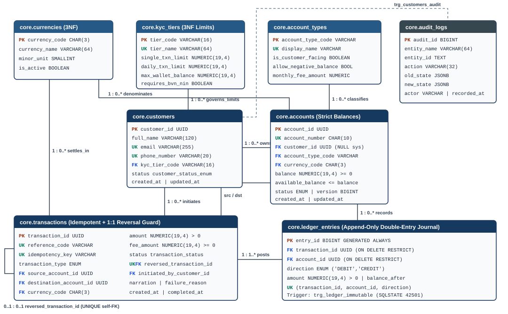

# MIT 8103 Advanced Database Systems — Individual Practical Database Portfolio

> **Course:** MIT 8103 Advanced Database Systems (2026/2027 Academic Session — First Semester Continuous Assessment)  
> **Assessment:** Individual Practical Database Portfolio (40 Marks)  
> **LMS Submission PDF:** [Kolawole_Damilola_Ayodeji_301906206_MIT8103_Portfolio.pdf](Kolawole_Damilola_Ayodeji_301906206_MIT8103_Portfolio.pdf)

---

## 1. Student & Repository Details
- **Student Name:** Kolawole Damilola Ayodeji
- **Matriculation Number:** `301906206`
- **Private GitHub Repository:** https://github.com/Klassique1/Kolawole_Damilola_301906206
- **Selected Organisation / Case Study:** **NovaPay Fintech Ltd** *(Simulated Digital Banking & Instant Payment Platform)*

---

## 2. Selected Organisation & Case Study Statement
**NovaPay Fintech Ltd** operates a digital wallet and instant payment platform supporting tiered KYC onboarding, multi-currency wallet management, peer-to-peer (P2P) instant transfers, external bank clearing deposits and withdrawals, authorised transaction reversals, double-entry ledger reconciliation, and real-time fraud risk scoring.

- **Database Users:** Retail & Business Customers (balances/transfers/statements), Operations & Settlement Officers (reversals/reconciliation), Compliance & Fraud Analysts (immutable ledger & telemetry auditing), and Database Administrators (schema tuning, locking, partitioning, and failover).
- **Major Data Stored:** Relational core (`novapay_core` on **PostgreSQL 17.11**) stores `currencies`, `kyc_tiers`, `account_types`, `customers`, `accounts`, `transactions`, append-only double-entry `ledger_entries`, and `audit_logs`. Polyglot NoSQL telemetry (`novapay_telemetry` on **MongoDB 9.0.4**) stores polymorphic fraud risk events (`fraud_risk_events`).
- **Key Operations Supported:** Atomic P2P transfers, idempotent retries, single-use reversals, paginated wallet statements, daily reconciliation summaries, double-spend concurrency protection, and rule-based fraud telemetry analysis.

---

## 3. Summary of Practical Portfolio Activities (1–5)

### Portfolio 1: Database Design and Modelling
Designed a normalised **3NF / BCNF** schema (`core` schema on PostgreSQL 17.11) extracting tiered KYC rules (`core.kyc_tiers`) and account product settings (`core.account_types`) out of transactional tables to eliminate transitive dependencies, while declaring candidate keys (`account_number`, `reference_code`, `idempotency_key`) as `UNIQUE`. All financial values use `NUMERIC(19, 4)` rather than floating point. Verification across **104** active constraints confirmed `0.0000` transaction trial-balance imbalance (`v_transaction_trial_balance`), `0.0000` account balance variance (`v_account_reconciliation`), closed-loop `SUM(balance) = 0.0000` against `EXTERNAL_CONTRA`, append-only `UPDATE` rejection (`SQLSTATE 42501`), and `CHECK` overdraft rejection (`SQLSTATE 23514`).  
Visual ER Diagram: 

### Portfolio 2: Query Processing and Optimisation
Populated `novapay_core` to **100,005 transactions** and **190,210 double-entry ledger postings** across 2,005 accounts, then measured four production queries using `EXPLAIN (ANALYZE, BUFFERS)` before and after index deployment:
- **Q1 (Paginated Statement):** Covering composite index `idx_ledger_account_posted_desc` (`INCLUDE`) replaced `Seq Scan + Sort` (`9.691 ms`, `2,928` buffers) with **`Index Only Scan`** (`0.038 ms`, `4` buffers — **255.03x faster**).
- **Q2 (High-Value `FAILED`/`PENDING` Screening):** Partial index `idx_txn_non_completed_recent` (`168 kB`, `WHERE status IN ('FAILED','PENDING')`) replaced `Seq Scan` (`13.394 ms`, `2,509` buffers) with `Bitmap Heap/Index Scan` (`0.116 ms`, `21` buffers — **115.47x faster**).
- **Q3 (14-Day Settlement Reconciliation):** Covering index `idx_txn_status_created_cover` accelerated aggregation from `27.509 ms` (`2,509` buffers) to `2.825 ms` (`48` buffers — **9.74x faster**).
- **Q4 (Case-Insensitive KYC Lookup):** Expression index `idx_customers_lower_email` plus partial FK index `idx_accounts_customer_id` reduced query latency from `0.824 ms` (`103` buffers) to `0.045 ms` (`8` buffers — **18.31x faster**).

### Portfolio 3: Transactions and Concurrency
Implemented a barrier-synchronized multi-session Python/`psycopg` test harness verifying transactional integrity and anomaly mitigation:
- **Atomicity (`COMMIT` & `ROLLBACK`):** Committed a `25,000.0000 NGN` P2P transfer (`5288303692 -> 5628448696`) and confirmed an invalid `999,999 NGN` overdraft raised `SQLSTATE 23514`, rolling back the preceding credit completely.
- **Lost Update Reproduction:** Two concurrent unlocked `READ COMMITTED` sessions both read stale `50,000 NGN` and disbursed `40,000 NGN` twice (`stored_balance = 10,000` vs. `ledger_computed_balance = -30,000`, `variance = 40,000.0000`).
- **Pessimistic Locking & Ordered Deadlock Prevention:** `SELECT ... FOR UPDATE` serialized contention cleanly (`0.0000` variance). Unordered bidirectional locks (`X→Y` vs. `Y→X`) triggered `SQLSTATE 40P01` (`deadlock detected`), whereas canonical `ORDER BY account_id ASC FOR UPDATE` eliminated deadlocks completely.
- **Optimistic `SERIALIZABLE` (SSI) + Retry:** SSI aborted the conflicting concurrent writer with `SQLSTATE 40001`, and automatic retry re-evaluated balance and cleanly declined (`0.0000` variance).

### Portfolio 4: NoSQL and Advanced Data Models
Deployed `novapay_telemetry.fraud_risk_events` on **MongoDB 9.0.4** using strict `$jsonSchema` validation (`validationAction: "error"`) to capture channel-polymorphic metadata (`os`/`app_version` for mobile vs. `cell_tower_id` for USSD) and variable-length `rule_hits[]` arrays within single documents. MongoDB rejected invalid `risk_score: 150` payloads with error code `121`. Across **25,000 documents**, an ESR compound index `{ decision: 1, channel: 1, created_at: -1 }` reduced high-risk query time from `24 ms` (`SORT -> COLLSCAN`, `25,000` docs examined) to `8 ms` (`FETCH -> IXSCAN`, `625` docs examined), paired with a 90-day TTL retention index and aggregation pipelines surfacing top fraud rules (`BENEFICIARY_FAN_IN`, `GEO_MISMATCH`) and mule device clusters (`dev_mule_01..05`).

### Portfolio 5: Distributed and Cloud Database Exercise
Implemented declarative monthly `RANGE (posted_at)` partitioning on `core.ledger_entries_partitioned` with `ON CONFLICT DO NOTHING` backfill; `EXPLAIN (ANALYZE, BUFFERS)` verified **partition pruning** (an October 2026 filter scanned only `ledger_entries_p_2026_10`, `497` heap buffers, `6.130 ms`, pruning the other 8 partitions). Provisioned a live local **PostgreSQL 17 physical streaming standby replica** (`5432 -> 5433`), observing `pg_stat_replication` in state `streaming` (`sent_lsn = replay_lsn = 0/2B0B0770`), `pg_is_in_recovery() = True`, real-time marker propagation (`repl-probe-cee426c704`), and read-only enforcement (`SQLSTATE 25006`). Documented multi-AZ failover, `customer_id` hash sharding with 16-bucket clearing-pool striping, and CP vs. PA/EL CAP trade-offs.

---

## 4. Individual Technical Reflection
- **Key Design Choices:** Prioritising double-entry completeness (`EXTERNAL_CONTRA` + append-only `ledger_entries`) alongside `NUMERIC(19, 4)` ensured financial accountability could always be mathematically verified via views rather than trusting mutable balances alone. Pairing PostgreSQL with MongoDB strictly along workload boundaries—ACID financial ledger in PostgreSQL, polymorphic/TTL-expiring telemetry in MongoDB—avoided forcing schema flexibility onto money movement or locking overhead onto fraud analytics.
- **Technical Challenges & Debugging Lessons:** During 100k synthetic workload generation, `accounts_check` immediately caught an unbalanced transfer skew bug (`s % 50`) causing overdrafts on one wallet, fixed by changing transfer selection to coprime modulo distribution (`s % 53`). In concurrency testing, separating `isolation_level` outside connection strings in `psycopg` v3 and resetting the thread barrier after `SQLSTATE 40001` retries resolved retry deadlocks. Similarly, testing fresh case-study initialisation under PostgreSQL 17 surfaced `public` schema permission denial until `ensure_database()` was updated to assign database ownership directly to the configured least-privilege application role.

---

## 5. References & Academic Integrity / AI Use Declaration

### References
- PostgreSQL Global Development Group. (2025). *PostgreSQL 17 Documentation*. https://www.postgresql.org/docs/17/
- MongoDB Inc. (2025). *MongoDB Manual*. https://www.mongodb.com/docs/manual/
- Kleppmann, M. (2017). *Designing Data-Intensive Applications*. O'Reilly Media.
- Silberschatz, A., Korth, H. F., & Sudarshan, S. (2020). *Database System Concepts* (7th ed.). McGraw-Hill.

### AI Use Declaration (MIT 8103 Section 11)
- **I. AI Tool Used:** Antigravity AI Assistant.
- **II. Purpose of Use:** Assisting with reusable Python runner/CLI scaffolding (`core/`), DDL/SQL template drafting, Mermaid/SVG diagram generation, test harness boilerplate, and Markdown/PDF documentation structuring across Portfolios 1–5.
- **III. Human Review, Correction & Verification:** I selected the Fintech case study (`NovaPay Fintech Ltd`), approved local database installations and progressive milestones, provided isolated GitHub account configuration (`Klassique1`), and verified outputs end-to-end against live PostgreSQL 17.11 (`5432`/`5433`) and MongoDB 9.0.4 (`27017`) instances (catching and fixing `EXTERNAL_CONTRA` balancing, `s % 53` seed skew, `psycopg` v3 retry barrier logic, `useHttpPath` GCM matching, `ensure_database` ownership, and `pytest` unit tests — full itemized table in [AI_USE_DECLARATION.md](AI_USE_DECLARATION.md)).
