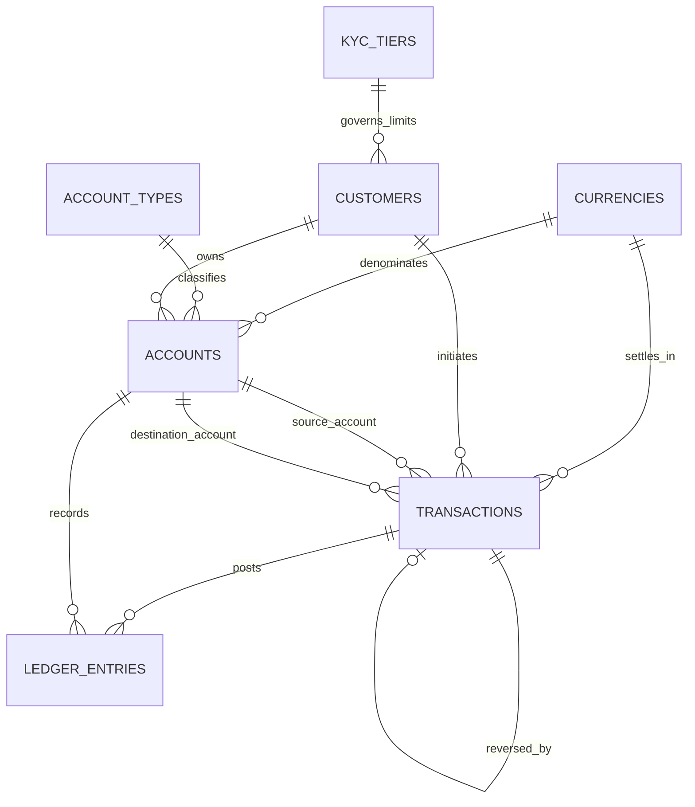

# Portfolio 1: Database Design and Modelling

> **Case Study:** NovaPay Fintech Ltd (`novapay_core`)
> **Engine:** PostgreSQL 17 (`core` schema)
> **Normal Form:** Third Normal Form (3NF) / Boyce–Codd Normal Form (BCNF)

---

## 1. Case Study Context & Requirements

**NovaPay Fintech Ltd** operates a digital wallet and instant payment platform supporting tiered customer onboarding (KYC), multi-account wallet management, peer-to-peer (P2P) transfers, external deposits/withdrawals, authorised reversals, and immutable double-entry ledger reconciliation.

### Key Entities & Cardinalities
- `core.kyc_tiers` **1 ──< 0..*** `core.customers`: Each customer is governed by exactly one KYC tier; each tier applies to many customers.
- `core.customers` **1 ──< 0..*** `core.accounts`: A customer may own one or more wallets (e.g., Savings and Current); internal system clearing/fee accounts have `customer_id = NULL`.
- `core.account_types` **1 ──< 0..*** `core.accounts` and `core.currencies` **1 ──< 0..*** `core.accounts`: Accounts are classified by product type and denominated in an ISO 4217 currency.
- `core.accounts` **1 ──< 0..*** `core.transactions` *(source / destination)*: A transaction debits/credits specific accounts depending on `transaction_type`.
- `core.transactions` **0..1 ── 0..1** `core.transactions` *(self-referencing `reversed_transaction_id`)*: Enforces a strict 1-to-1 reversal guarantee (`UNIQUE` FK) so a transaction can be reversed at most once.
- `core.transactions` **1 ──< 1..*** `core.ledger_entries`: Every completed financial movement generates balanced append-only `DEBIT` and `CREDIT` postings.
- `core.audit_logs`: Records automated trigger-captured KYC tier and customer lifecycle state changes.

---

## 2. Entity-Relationship Diagram (ER Diagram)

Source file: [diagrams/novapay_erd.mmd](diagrams/novapay_erd.mmd)



---

## 3. Normalisation Proof (1NF → 2NF → 3NF → BCNF)

| Normal Form | Design Decisions Applied in `novapay_core` |
| :--- | :--- |
| **1NF (Atomic Values & No Repeating Groups)** | Every column stores a single atomic value (`full_name`, `email`, `phone_number`, `amount`, `currency_code`). Repeating ledger lines or multiple accounts per customer are separated into `core.accounts` and `core.ledger_entries`. |
| **2NF (No Partial Dependencies)** | All primary keys are single-column surrogate keys (`UUID` or `BIGINT IDENTITY`), eliminating partial functional dependencies on composite keys. Ledger lines depend fully on `entry_id`, with natural uniqueness enforced via `UNIQUE (transaction_id, account_id, direction)`. |
| **3NF (No Transitive Dependencies)** | Non-key attributes depend *only* on the primary key. For example, KYC transaction limits (`single_txn_limit`, `daily_txn_limit`, `max_wallet_balance`) depend on `tier_code`, not `customer_id`, so they are extracted into `core.kyc_tiers`. Account metadata (`display_name`, `allow_negative_balance`, `monthly_fee_amount`) is extracted into `core.account_types`. |
| **BCNF (Every Determinant is a Candidate Key)** | In every table, every functional dependency `X → Y` has `X` as a superkey (e.g., `account_number → account_id`, `reference_code → transaction_id`, `idempotency_key → transaction_id` are all declared `UNIQUE` candidate keys). |

---

## 4. Keys, Constraints & Production Financial Controls

1. **Exact Decimal Precision (`NUMERIC(19, 4)`):** Eliminates IEEE-754 floating-point rounding drift in monetary balances and ledger amounts.
2. **Domain & Regex Validation (`CHECK`):**
   - `account_number ~ '^[0-9]{10}$'` (10-digit NUBAN-style account number)
   - `currency_code ~ '^[A-Z]{3}$'`, `phone_number ~ '^\+[1-9][0-9]{7,14}$'`
   - `balance >= 0`, `available_balance BETWEEN 0 AND balance`, `amount > 0`
   - `chk_txn_accounts_by_type` ensures `TRANSFER` has two distinct accounts, `DEPOSIT` has only a destination, `WITHDRAWAL` has only a source, and `REVERSAL` references `reversed_transaction_id`.
3. **Referential Integrity (`ON DELETE RESTRICT`):** Financial customers, accounts, and transactions cannot be deleted while ledger history exists.
4. **Append-Only Ledger Immutability (`trg_ledger_immutable`):** Blocks `UPDATE` and `DELETE` on `core.ledger_entries` at the database engine layer (`SQLSTATE 42501`).
5. **Idempotency & Double-Reversal Prevention:** `UNIQUE (idempotency_key)` prevents duplicate retries; `UNIQUE (reversed_transaction_id)` prevents reversing the same transaction twice.
6. **Closed-Loop Double-Entry Accounting (`EXTERNAL_CONTRA`):** External funding inflows/outflows balance against `EXTERNAL_CONTRA`, ensuring every transaction satisfies `SUM(DEBIT) = SUM(CREDIT)` (`net_imbalance = 0`) and system-wide `SUM(balance) = 0`.

---

## 5. Implementation Files & Verification

- [sql/001_init_schema.sql](sql/001_init_schema.sql) — Schema, custom ENUMs, reference tables
- [sql/002_core_tables.sql](sql/002_core_tables.sql) — Core transactional & immutable ledger tables
- [sql/003_triggers_and_invariants.sql](sql/003_triggers_and_invariants.sql) — Triggers, immutability guard, reconciliation views
- [sql/004_seed_sample_data.sql](sql/004_seed_sample_data.sql) — Reference & deterministic sample transactions
- [sql/005_verification_queries.sql](sql/005_verification_queries.sql) — Manual verification queries
- [run_portfolio_1.py](run_portfolio_1.py) — Automated migration + evidence exporter

### Run & Verify
```powershell
python portfolio-1-database-design/run_portfolio_1.py
```
Outputs are saved to `portfolio-1-database-design/evidence/`.
