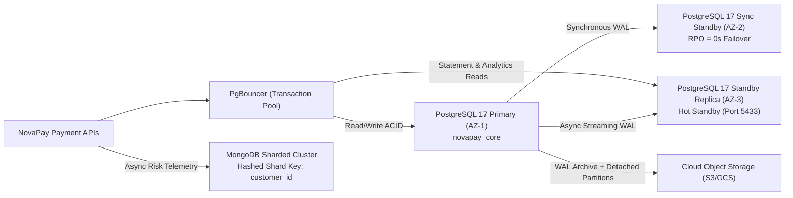

# Portfolio 5: Distributed and Cloud Database Exercise

> **Case Study:** NovaPay Fintech Ltd (`novapay_core` + `novapay_telemetry`)
> **Architecture:** Hybrid Multi-AZ Relational Primary/Standby + Declarative Partitioning + Hashed NoSQL Sharding

---

## 1. Distributed & Cloud Reference Topology

Configuration blueprint: [configs/distributed_topology.yaml](configs/distributed_topology.yaml)

---

## 2. Partitioning Strategy (Vertical & Temporal Scalability)

Implemented in [sql/001_partitioned_ledger.sql](sql/001_partitioned_ledger.sql):
- **Strategy:** Declarative `RANGE (posted_at)` monthly partitioning on `core.ledger_entries_partitioned`.
- **Why Monthly Range Partitioning:**
  1. **Partition Pruning:** Date-bounded statement queries touch only the target month's B-Tree index rather than scanning multi-year history.
  2. **Zero-Lock Archival:** Expired regulatory partitions (e.g., > 12 months hot) can be detached (`ALTER TABLE ... DETACH PARTITION CONCURRENTLY`), exported to Parquet on cloud object storage (`S3`/`GCS`), and dropped without table-wide `VACUUM` bloat.

---

## 3. Sharding Strategy & Hotspot Avoidance

When scaling `novapay_core` horizontally (e.g., via PostgreSQL Citus) and `novapay_telemetry` (MongoDB):

| Layer | Shard Key | Routing & Hotspot Mitigation |
| :--- | :--- | :--- |
| **PostgreSQL Core** (`accounts`, `ledger_entries`) | `customer_id` (hash-distributed) | Co-locates a customer's profile, wallets, and ledger entries on one shard so single-customer balance reads stay single-shard. **Hotspot mitigation:** Internal clearing accounts (`SETTLEMENT_POOL`, `FEE_REVENUE`) are striped into 16 sub-buckets (`pool_00..pool_15`) selected by `abs(hashtext(txn_id)) % 16` to avoid single-row lock serialization. |
| **MongoDB Telemetry** (`fraud_risk_events`) | `{ customer_id: "hashed" }` | Prevents monotonic timestamp hotspots on the newest shard while distributing write velocity uniformly across shards. |

---

## 4. CAP & PACELC Consistency Trade-Offs

| Subsystem | CAP / PACELC Profile | Design Justification |
| :--- | :--- | :--- |
| **Core Wallet Transfers & Ledger** | **CP / PC-EC** | Under network partitions, double-spend prevention requires rejecting uncoordinated writes rather than risking conflicting balances. Uses synchronous standby commit (`remote_apply`) in AZ-2 for zero RPO. |
| **Account Statements & Dashboards** | **PA / EL** (Bounded Staleness) | Offloaded to streaming read replicas (`hot_standby = on`). Minor sub-second replication lag is acceptable for historical views; immediate post-transfer screens use read-your-own-writes routing to Primary. |
| **Fraud Telemetry & Analytics** | **PA / EC** (Tunable `w: "majority"`) | MongoDB replica sets preserve availability during single-node failure while `w: "majority"` protects committed fraud alerts from rollback. |

---

## 5. Practical Implementation & Observed Verification

- Partitioning DDL & migration: [sql/001_partitioned_ledger.sql](sql/001_partitioned_ledger.sql)
- Topology YAML spec: [configs/distributed_topology.yaml](configs/distributed_topology.yaml)
- Verification runner: [run_portfolio_5.py](run_portfolio_5.py)
- Captured verification outputs: [evidence/portfolio_5_evidence.md](evidence/portfolio_5_evidence.md) and [evidence/portfolio_5_evidence.json](evidence/portfolio_5_evidence.json)

### Key Verified Results
1. **Declarative Partition Pruning:** Querying `posted_at` for October 2026 scanned **only `ledger_entries_p_2026_10`** (`32,244` rows, `497` heap buffers, `6.130 ms`), pruning the other 8 partitions completely.
2. **Live Physical Streaming Replication (Primary `5432` → Hot Standby `5433`):**
   - `pg_stat_replication` confirmed `walreceiver` state `streaming` with `sent_lsn = replay_lsn` (`0/2B0B0770`).
   - Standby reported `pg_is_in_recovery() = True`, replicated the live write probe (`repl-probe-cee426c704`), and rejected write attempts with `SQLSTATE 25006` (`cannot execute INSERT in a read-only transaction`).
